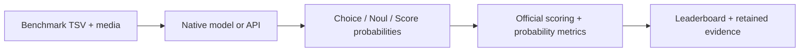

<div align="center">

# JevalKit

**A unified evaluation toolkit for Jev-like decision models.**

Text, images and video in. Choice, Noul and Score probabilities out.

[](LICENSE)
[](pyproject.toml)
[](#supported-models)
[](#supported-benchmarks)

[Leaderboard](leaderboard/README.md) · [Quick Start](#quick-start) · [Models](#supported-models) · [Benchmarks](#supported-benchmarks) · [Documentation](#documentation) · [Contributing](#contributing)

</div>

JevalKit evaluates models that return **probabilities over decisions defined at
request time**: a yes/no judgment, a choice among named options, or a rating on an
ordered scale. It brings model adapters, benchmark preparation, scoring and result
comparison into one workflow, following the registry-based design of
[VLMEvalKit](https://github.com/open-compass/VLMEvalKit).

## Highlights

- **20 model families in one registry.** Run open checkpoints through their native
  decision interfaces and hosted models through their published APIs.
- **Text, image and video evidence.** Preserve shared states, multiple questions,
  candidate order and model-specific modality limits.
- **Evaluate the whole distribution.** Report accuracy alongside Brier, NLL,
  calibration and ordinal metrics, with benchmark-specific official scorers.
- **Reproduce and resume.** Retain dataset hashes, raw predictions, runtime
  provenance, failures and coverage; resume interrupted runs or score them again.
- **Compare measured results.** Browse Markdown, TSV and JSON leaderboards, with
  smoke tests, imported predictions and complete runs identified separately.



## Latest Updates

- **2026-10-18:** Published the initial implementation and evaluation results for
  **18 model families**, with **75 passing tests**. Jev and OpenAI-Decisions have
  implemented adapters; their live API measurements are pending.
- **2026-10-18:** Added Typed-Decisions, DecisionBench, Procedural Typed Decisions,
  zh-decision-bench and JevAlt-Bench: **8 Jev-related suites / 10 dataset views**.
  All new evaluation data is pinned and verified; full trained-model runs on the
  new suites remain pending.

## Quick Start

### 1. Install

```bash
git clone https://github.com/Liuziyu77/JevalKit.git
cd JevalKit
python -m pip install -e '.[hf,data]'
```

The CLI and scorers require Python 3.10+. Model inference uses the dependencies
specified by each author; some models require Python 3.12+ or a separate serving
environment. See the [model catalog](docs/models.md) and
[tested runtimes](docs/runtime-environments.md).

### 2. Choose a model and prepare data

Set a writable storage directory for datasets, media, checkpoints and results:

```bash
export JEVALKIT_DATA_ROOT=/path/to/jevalkit-data
python -m jevalkit list models
python -m jevalkit list benchmarks
python -m jevalkit prepare JevBench
```

### 3. Run and compare

```bash
python -m jevalkit run --model Valen-0.8B --data JevBench \
  --output "$JEVALKIT_DATA_ROOT/results"

python -m jevalkit leaderboard "$JEVALKIT_DATA_ROOT/results" \
  --output leaderboard
```

Pass `--option model=/path/to/checkpoint` to reuse existing weights. Use
`--limit 10` for a smoke test, or `--resume` to continue an interrupted run with
the same settings. [Full usage guide →](docs/quickstart.md)

## Supported Models

Size variants and Clef/Clef-Flash count within their respective families.
**Measured** means real inference has been verified for at least one registered
variant; per-benchmark coverage is shown in the [leaderboard](leaderboard/README.md).

| Family | Registered model IDs | Integration | Validation |
|---|---|---|---|
| [Valen](https://github.com/Liuziyu77/Valen) | `Valen-0.8B`, `Valen-2B`, `Valen-4B` | Native | Measured |
| [Intern-Decision](https://github.com/InternLM/Intern-Decision) | `Intern-Decision-0.8B`, `Intern-Decision-2B`, `Intern-Decision-4B` | Native | Measured |
| [Laya](https://github.com/NandhaKishorM/laya) | `Laya` | Native | Measured |
| [Liquid d1](https://huggingface.co/LiquidAI/d1-3B) | `Liquid-d1-3B` | Native | Measured |
| [vLLM Decision1](https://huggingface.co/vllm-sr/Decision-1.0-Kai-0.6B) | `Decision1-Kai` | Native | Measured |
| [Clef](https://huggingface.co/Cloudflare/clef) | `Clef`, `Clef-Flash` | Native | Measured |
| [Pplx-Decider](https://huggingface.co/perplexity-ai/pplx-decider-v1.1-27b) | `Pplx-Decider` | Native | Measured |
| [JevK5](https://huggingface.co/alibiserikbay/JevK5) | `JevK5` | Native | Measured |
| [StartLux](https://huggingface.co/startlux-models/StartLux-Decision-v1-0.8B) | `StartLux-0.8B` | Native | Measured |
| [Crivo](https://huggingface.co/tardellirs/crivo-150m) | `Crivo-150M` | Native | Measured |
| [RSI-Jev](https://github.com/Shanghua-Gao/RSI-Jev) | `RSI-Jev-v4` | Native | Measured |
| [Vjev](https://huggingface.co/yah01/vjev-vision) | `Vjev-4B` | Native | Measured |
| [QEV](https://github.com/ken-jo/qev) | `QEV` | Native | Measured |
| [OmniJev](https://github.com/tinnel123666888/OmniJev) | `OmniJev` | Native | Measured |
| [Visual-Jev](https://github.com/guanxuyu-sv/Visual-Jev) | `Visual-Jev` | Native | Measured |
| [Kev](https://github.com/jaredpalmer/kev) | `Kev` | Author server | Measured |
| [H2O-Lightning](https://huggingface.co/h2oai/h2o-lightning-4b) | `H2O-Lightning` | Author server | Measured |
| [OpenJev](https://huggingface.co/openjev/openjev) | `OpenJev` | Author server | Measured |
| [Jev](https://typesafe.ai) | `Jev` | Hosted API | Live evaluation pending |
| [OpenAI Decisions](https://developers.openai.com/api/docs/guides/decisions) | `OpenAI-Decisions` | Hosted API | Live evaluation pending |

The catalog also includes a `Uniform` diagnostic baseline. Author dependencies,
context limits, supported question types and media contracts are documented in
the [integration guide](docs/models.md).

## Supported Benchmarks

### Jev-related suites

| Suite | Modality | Released evaluation | Main measurements |
|---|---|---|---|
| [VisualDecisionBench](https://huggingface.co/datasets/Valen-Team/VisualDecisionBench) | Image + video | 1,696 states; 9,143 questions | Accuracy, soft-target Brier/NLL, ordinal metrics |
| [JevBench](https://github.com/fstandhartinger/jevbench) | Text | 231 public tasks across easy/original/hard tiers | Official task scores and calibration |
| [Decision Index](https://huggingface.co/spaces/multimodalart/jev-decision-index) | Text | Edition 0.3 public suite; 43 constituent datasets | Official chance-corrected, weighted public index |
| [Typed-Decisions](https://huggingface.co/datasets/LocalLLaMA/typed-decisions) | Text | 400 states; 2,000 decisions | Modal accuracy, KL and soft-target Brier |
| [DecisionBench](https://huggingface.co/datasets/Hanno-Labs/decision-bench) | Text | 23,900 evaluation rows; 43 tasks | Accuracy, reference NLL and calibration |
| [Procedural Typed Decisions](https://huggingface.co/datasets/tasksource/procedural-typed-decisions) | Text | 18,000 test states; 57,016 questions | Rule execution and exact probability judgments |
| [zh-decision-bench](https://github.com/CodyQin/zh-decision-bench) | Chinese text | v0.2: 378 items; 467 questions | Routing, moderation, ordinal ratings and calibration |
| [JevAlt-Bench](https://huggingface.co/datasets/mertkayacs/jevalt-bench) | English, Turkish, German text | 3,116 test states; 8,434 questions | Labeled and soft-probability decisions; language slices |

VisualDecisionBench's image and video views belong to the same benchmark.
Decision Index public scores and its private leaderboard components are reported
separately. See the [frozen data inventory](docs/data-manifest.json) and
[scoring protocols](docs/benchmarks.md).

Prepare the five new suites together:

```bash
python -m jevalkit prepare TypedDecisions DecisionBench ProceduralTypedDecisions \
  ZhDecisionBench JevAltBench
```

Use the [matrix example](examples/decision-benchmarks.json) for a full evaluation.
The new suites have passed complete data checks and CPU pipeline smoke checks;
those diagnostics do not add trained-model scores to the leaderboard. Protocol
notes cover soft references, candidate mappings, and JevAlt's explicit `unknown`
projection. Other candidates remain in the [benchmark research](docs/benchmarks.md#benchmark-research).

## Evaluation Results

The current snapshot contains **68 retained run artifacts** and **40 eligible
primary full scores**. The table below shows selected completed measurements;
all entries have 100% question coverage.

| Model | JevBench accuracy | VDB Image accuracy |
|---|---:|---:|
| Pplx-Decider | 89.18% | 86.88% |
| OpenJev | 87.45% | 83.12% |
| H2O-Lightning | 87.45% | 82.06% |
| Valen-4B | 83.55% | 83.12% |
| Clef-Flash | 82.68% | 82.24% |

VDB Image accuracy uses its 1,700 hard-label questions; all 2,000 questions
contribute probability metrics. The full board reports protocols, hardware,
coverage and provenance, and selects the latest complete run for each matching
model/data/protocol combination.

**[Browse leaderboard →](leaderboard/README.md)** ·
[Download TSV](leaderboard/leaderboard.tsv) ·
[Download JSON](leaderboard/leaderboard.json) ·
[Validation status](docs/STATUS.md)

Scores here come from retained predictions. Author-reported benchmark numbers
belong in the research notes, not in the measured leaderboard. Raw evidence paths
refer to the evaluation workspace; the committed tables can be browsed without it.

## Documentation

| Guide | Contents |
|---|---|
| [Running evaluations](docs/quickstart.md) | Installation, preparation, resume, API runs, matrices and cluster execution |
| [Model integrations](docs/models.md) | Native adapters, author servers, dependencies and input limits |
| [Benchmark protocols](docs/benchmarks.md) | Splits, metrics, official scorers and benchmark research |
| [Tested runtimes](docs/runtime-environments.md) | Model-specific environment versions |
| [Validation status](docs/STATUS.md) | Verified results and remaining live API evaluations |
| [Third-party terms](THIRD_PARTY.md) | Source attribution and dataset/model licensing |

## Contributing

Model adapters live in `jevalkit/models/` and are registered in
[`jevalkit/config.py`](jevalkit/config.py). Benchmark loaders live in
`jevalkit/datasets/`, with scoring in `jevalkit/scoring.py`. Contributions should
preserve native probabilities, candidate order and the published scoring protocol.
Include reproducible commands and the relevant validation when adding a model,
dataset or result.

```bash
python -m pip install -e '.[test]'
PYTEST_DISABLE_PLUGIN_AUTOLOAD=1 python -m pytest -q
```

Bug reports and contributions are welcome through
[Issues](https://github.com/Liuziyu77/JevalKit/issues) and
[Pull Requests](https://github.com/Liuziyu77/JevalKit/pulls).

## License and Acknowledgements

JevalKit is released under [Apache-2.0](LICENSE). Model weights, datasets and
vendored code retain their own licenses; see [THIRD_PARTY.md](THIRD_PARTY.md).
We thank [VLMEvalKit](https://github.com/open-compass/VLMEvalKit) for its evaluation
toolkit design, and the authors of the integrated decision models and benchmarks.
